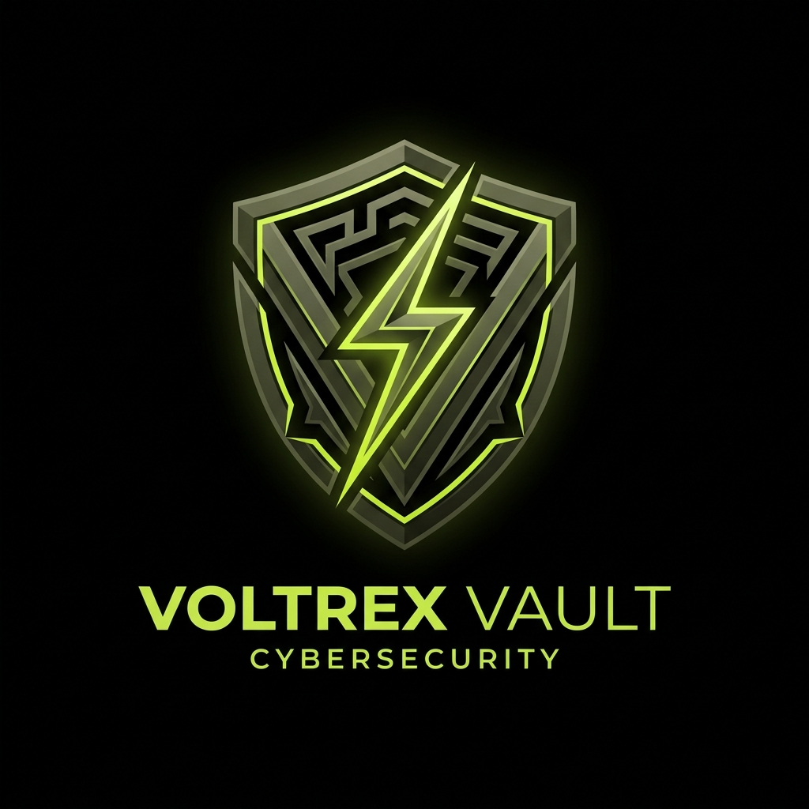

# Voltrex Vault

[](LICENSE)
[](tsconfig.json)

<p align="center">
  
</p>

Voltrex Vault is a free, open-source, local-first password and secrets manager built with **Electron**, **React**, **TypeScript (Strict Mode)**, **Vite**, **MUI (Material UI)**, **Tailwind CSS**, and **SQLite**. It features authenticated AES-256-GCM encryption, Argon2id key derivation, zero-knowledge Google Drive backups, direct GitHub release updates, and an automated multi-platform packaging system for Windows and Linux.

> **Documentation**: [Threat Model](docs/THREAT_MODEL.md) | [Architecture](docs/ARCHITECTURE.md) | [Security Policy](SECURITY.md) | [Contributing](CONTRIBUTING.md) | [License](LICENSE)

---

## 1. Architecture Overview

Voltrex Vault adheres to the principle of least privilege, establishing strict boundary separation across three isolated processes:

```
┌─────────────────────────────────────────────────────────────┐
│                       Renderer Process                      │
│   React 18 + MUI + Tailwind CSS + Lucide Icons (WebContext) │
│   - Strictly Sandboxed (sandbox: true, nodeIntegration: false)│
│   - Restrictive Content Security Policy                     │
└──────────────────────────────┬──────────────────────────────┘
                               │
            window.vaultApi    │ (Narrow, Typed contextBridge API)
                               ▼
┌─────────────────────────────────────────────────────────────┐
│                        Preload Script                       │
│   - contextIsolation: true                                  │
│   - Zero exposure of ipcRenderer, Node.js, or filesystem    │
│   - Wraps and validates IPC calls                           │
└──────────────────────────────┬──────────────────────────────┘
                               │
          Strict IPC Channels   │ (Frame & Schema Validation)
                               ▼
┌─────────────────────────────────────────────────────────────┐
│                         Main Process                        │
│   - Trusted Node.js runtime                                 │
│   - AES-256-GCM authenticated cipher engine                 │
│   - Argon2id KDF + HKDF-SHA256 key separation               │
│   - SQLite Persistence via WebAssembly (sql.js)             │
│   - Backup Scheduler (Debounced & Periodic)                │
│   - Google Drive Service (OAuth 2.0 PKCE + drive.file)      │
│   - In-memory key zeroization on lock/exit                  │
└─────────────────────────────────────────────────────────────┘
```

---

## 2. Cryptographic Specification

### A. Key Derivation & Separation
- **KDF Algorithm**: Argon2id via `hash-wasm` (verified WebAssembly binary with zero native compilation dependencies).
- **Argon2id Parameters**:
  - Memory: `65,536 KiB` (64 MiB)
  - Iterations (`time`): `3`
  - Parallelism: `1`
  - Salt: Cryptographically secure random 32-byte salt (`crypto.randomBytes(32)`).
  - Output Key: 32-byte Master Key.
- **Key Separation via HKDF-SHA256**:
  - `KEK` (Key Encryption Key) = `HKDF-SHA256(MasterKey, info="voltrex-vault-kek-v1", length=32)`
  - `AuthKey` (Authentication Token Key) = `HKDF-SHA256(MasterKey, info="voltrex-vault-auth-v1", length=32)`

### B. Two-Tier Key Hierarchy
1. A random 256-bit **Data Encryption Key (DEK)** is generated using `crypto.randomBytes(32)`.
2. The DEK is encrypted under the KEK using AES-256-GCM with a unique 12-byte IV, producing `encryptedDek` and a 16-byte auth tag.
3. Each individual item payload (credentials, notes, cards, identities) is encrypted under the DEK with AES-256-GCM using a **fresh, unique 12-byte nonce/IV** generated per write operation.
4. An auth verification sentinel token (`"voltrex-vault-auth-token-v1"`) is encrypted under `AuthKey`. This enables instant password validation without exposing or decrypting the DEK.
5. **Master Password Rotation**: Changing the master password re-derives a new KEK with a fresh salt and re-wraps the existing DEK atomically, eliminating the need to re-encrypt every item in the database.

---

## 3. Phase 2: Google Drive & Encrypted Backups

Voltrex Vault provides zero-knowledge, encrypted cloud backups to the user's personal Google Drive account, as well as local encrypted container exports (`.voltrex`).

### A. Architectural Principles
- **No Voltrex Cloud Backend**: Voltrex Vault has zero proprietary cloud servers, zero telemetry, and zero intermediary services. All communications travel directly between the user's desktop application and official Google APIs.
- **Local-First & Offline Resilience**: Voltrex Vault remains fully functional without an internet connection. If offline, scheduled backups gracefully defer without blocking local operations.
- **Backup & Restore, NOT Multi-Master Sync**: Backups represent immutable encrypted snapshots. There is no silent, unprompted last-write-wins merging or concurrent multi-client state corruption.

### B. Google OAuth 2.0 PKCE Flow
- **RFC 7636 PKCE (Proof Key for Code Exchange)**:
  - Generates a cryptographically random 32-byte `code_verifier` (base64url).
  - Derives `code_challenge = BASE64URL(SHA256(code_verifier))`.
  - Generates a random 16-byte `state` parameter to prevent CSRF.
- **Installed App Loopback Server**:
  - Starts a temporary local HTTP server on `127.0.0.1` on an ephemeral OS-assigned port.
  - Launches the user's default operating system browser via `shell.openExternal`.
  - Captures the authorization code from the redirect URI (`http://127.0.0.1:<port>`), exchanges it for tokens with Google, and immediately terminates the server.
- **Restricted Scope**:
  - `https://www.googleapis.com/auth/drive.file`: Gives the app access **only** to files that Voltrex Vault itself creates. It cannot view, list, or modify any personal documents, photos, or other files in the user's Google Drive.
- **Token Security**:
  - Tokens are stored locally on the user's device encrypted via Electron's `safeStorage` (which uses OS keychains: DPAPI on Windows, Keychain on macOS, Secret Service / libsecret on Linux) with restrictive `0600` file permissions.
  - No client secrets are stored in code or repository commits.

### C. Encrypted Container Format (`voltrex-vault-encrypted-backup-v1`)
The backup file format is completely portable and cross-device compatible. It requires only the master password to restore on any device, with no machine-specific or TPM hardware identifiers embedded.

```json
{
  "format": "voltrex-vault-encrypted-backup",
  "version": 1,
  "backupId": "UUID",
  "vaultId": "UUID",
  "appVersion": "1.0.0",
  "createdAt": 1729350000000,
  "itemCount": 42,
  "kdf": {
    "algorithm": "argon2id",
    "params": {
      "memoryKiB": 65536,
      "iterations": 3,
      "parallelism": 1,
      "hashLength": 32
    },
    "saltHex": "..."
  },
  "cipher": {
    "algorithm": "aes-256-gcm",
    "keyBits": 256,
    "ivBits": 96,
    "tagBits": 128
  },
  "encryptedDek": {
    "ciphertextHex": "...",
    "ivHex": "...",
    "tagHex": "..."
  },
  "authCheck": {
    "ciphertextHex": "...",
    "ivHex": "...",
    "tagHex": "..."
  },
  "payload": {
    "ciphertextHex": "...",
    "ivHex": "...",
    "tagHex": "..."
  }
}
```

### D. Automated Scheduler & Retention Pruning
- **Change Debouncing**: When entries are added, modified, or trashed, a backup is scheduled with a 20-second debounce window.
- **Periodic Backups**: Configurable interval (15m, 30m, 1h, 6h, 24h).
- **Exponential Backoff**: Transient network errors trigger retries with exponential backoff and randomized jitter (up to 3 retries max).
- **Retention Pruning**: Retains up to `N` most recent backups (default 5, configurable), automatically pruning older backups while **strictly preserving the last known-good backup** at all times.

### E. Safe Atomic Restore & Safety Snapshots
- **Container Verification**: Prior to modifying local storage, the backup container structure is validated, KDF keys derived, and auth tags checked.
- **Pre-Restore Safety Snapshot**: Before replacing local SQLite data, an atomic copy of the current database is saved as `pre-restore-snapshot-<timestamp>.db` with `0600` permissions.
- **Conflict Comparison**: The UI presents an explicit comparison between the active vault and backup container (item counts, last modified dates, and a prominent warning if the backup originated from a different `vaultId`).
- **Atomic Transaction**: Local database entries are updated within an atomic SQLite transaction. If any failure occurs, the database is rolled back immediately to the safety snapshot.

---

## 4. Software Updates & GitHub Releases

Voltrex Vault includes a zero-telemetry software update system fetching directly from official GitHub Releases (`ziard47/voltrex-vault`).

### A. Architectural & Security Principles
- **Strict CSP Enforcement**: The desktop renderer enforces `connect-src 'none';` to prevent accidental data exfiltration. All release queries and downloads execute exclusively in Electron's trusted Main Process via secure IPC channels (`window.vaultApi.updates.*`).
- **Semantic Versioning**: Automatically checks release tags via semver comparison (`compareVersions`).
- **Graceful Offline & 404 Handling**: If GitHub has no tagged releases yet or the system is offline, the app handles it cleanly without crashing or blocking user workflow.
- **Direct Streaming Downloader**: Updates are streamed directly into the user's OS `Downloads` folder using Node 22 native `fetch` and piped streams, reporting chunk-by-chunk download percentages and byte progress.

### B. In-App User Experience
- **Sidebar Notification**: A pulsating notification dot appears on the sidebar when a newer release is detected.
- **Settings > Software Updates**:
  - Displays current version and latest available version.
  - Manual **"Check for Updates"** button and direct link to GitHub Releases.
  - Release notes preview and recommended installer asset detection (Windows `.exe`, Linux `.tar.gz`/`.AppImage`).
  - Real-time download progress bar with percentage and transferred/total megabytes.
  - Post-download action buttons: **"Run Installer"** and **"Show in Folder"**.

---

## 5. Packaging & Distribution System

Voltrex Vault provides an automated, unified packaging system targeting Windows and Linux desktop environments.

### A. Interactive Version Prompting
When executing packaging scripts in an interactive terminal, the CLI prompts for a version number:
```
========================================
   Voltrex Vault Packaging System
========================================

Enter version number to package (default: 1.0.0):
```
- Pressing <kbd>Enter</kbd> (or running in non-interactive/CI pipelines) defaults automatically to the `version` declared in `package.json`.
- Entering a custom version (e.g., `1.1.0` or `v1.1.0`) packages with that specified version.
- Version flags can also be provided directly via CLI: `--version 1.2.0` or `-v 1.2.0`.

### B. Distribution Directory Layout
All packaged outputs are created inside a structured `releases/` folder:
```
releases/
├── windows/
│   └── <version>/
│       ├── Voltrex-Vault-Setup-<version>.exe  (NSIS Setup Installer)
│       └── Voltrex-Vault-Setup-<version>.exe.blockmap
└── linux/
    └── <version>/
        ├── voltrex-vault-<version>-x64.tar.gz  (Linux tar.gz Setup Archive)
        └── voltrex-vault-<version>-x86_64.AppImage (AppImage)
```

### C. Packaging Commands

| Command | Target | Output Artifact |
| :--- | :--- | :--- |
| `npm run package:win` | Windows | NSIS Setup executable (`Voltrex-Vault-Setup-<version>.exe`) |
| `npm run package:linux` | Linux | Setup archive (`voltrex-vault-<version>-x64.tar.gz`) + AppImage |
| `npm run package:all` | All | Windows installer and Linux packages |
| `npm run package` | Interactive | Menu selector allowing user to choose target |

> **Linux AppImage Note**: AppImages require Linux filesystem utilities (`mksquashfs`). When building on a Windows host without Docker, the `.tar.gz` archive is compiled natively and a helpful diagnostic notice is displayed. In Linux environments or CI/CD pipelines, both `.tar.gz` and `.AppImage` build automatically.

---

## 6. Threat Model & Security Guarantees

| Attack Vector | Mitigation / Guarantee |
| :--- | :--- |
| **Database Stolen at Rest** | Plaintext credentials, notes, and keys are NEVER written to disk. All payloads are AES-256-GCM encrypted. SQLite database file is written with restrictive `0600` permissions. |
| **Ciphertext Tampering** | AES-256-GCM authenticates ciphertext with a 128-bit authentication tag. Tampering with any byte causes immediate rejection (`CryptoIntegrityError`). |
| **Google Cloud Interception** | Cloud storage receives only authenticated AES-256-GCM ciphertext. The master password and raw DEK are never transmitted over the network. |
| **Google Account Compromise** | An attacker with access to the user's Google Drive cannot decrypt the backup containers without the master password (protected by 64 MiB Argon2id). |
| **Renderer / XSS Exploits** | Strict CSP (`connect-src 'none'`). Preload exposes only validated, typed methods. Navigation locks prevent external redirects. |
| **IPC Spoofing** | Every IPC invocation verifies that `event.senderFrame` corresponds strictly to the trusted mainWindow mainFrame. |
| **Memory Snooping** | In-memory key buffers (DEK, KEK, MasterKey) are zeroized with `buf.fill(0)` immediately upon vault locking or application exit. |

---

## 7. Build, Test, and Launch Instructions

### Prerequisites
- Node.js `>= 18` (Tested on `v22.8.0` / `v24.x`)
- npm `>= 9` (Tested on `10.8.2` / `11.x`)

### Installation
```bash
npm install
```

### Running Tests
Execute the full Vitest suite covering cryptography, backup containers, atomic restore, Google Drive PKCE, storage, and GitHub update checking:
```bash
npm test
```

### Type Checking
Validate strict TypeScript compilation across desktop renderer and Electron processes:
```bash
npm run typecheck
```

### Building Application Artifacts
Build the desktop application (Vite desktop bundle and Electron processes):
```bash
npm run build
```

Or build individual targets:
```bash
npm run build:vite       # Desktop React renderer
npm run build:electron   # Electron main and preload
```

### Packaging for Release
Package distributables into the `releases/` directory:
```bash
# Windows Setup Installer (NSIS)
npm run package:win

# Linux tar.gz and AppImage
npm run package:linux

# Package All Desktop Platforms
npm run package:all
```

### Launching the Desktop Application
Start the desktop application in production mode:
```bash
npm start
```

Or run in development mode with Vite HMR:
```bash
# Terminal 1: Vite dev server
npm run dev:vite

# Terminal 2: Electron application
npm run dev:electron
```


